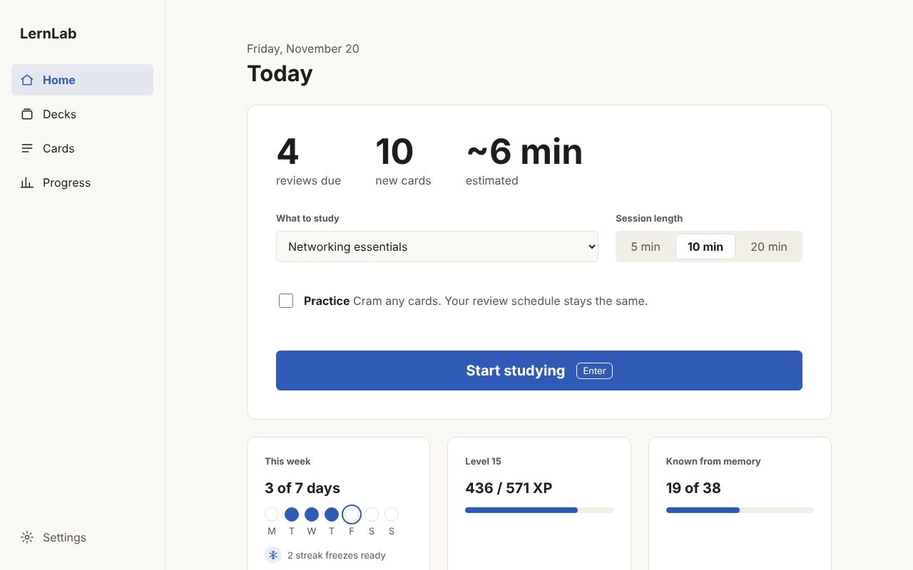
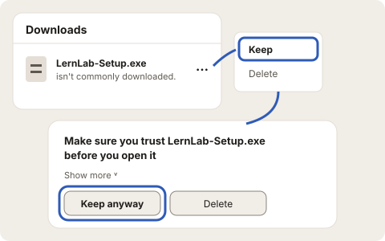
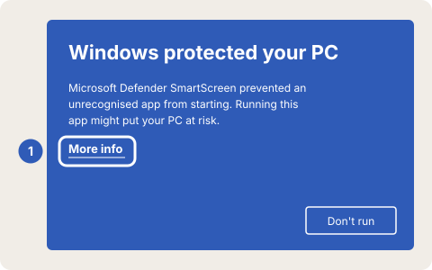
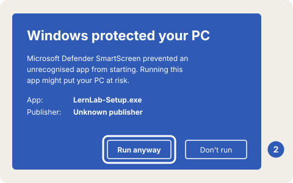
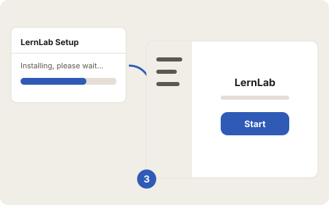
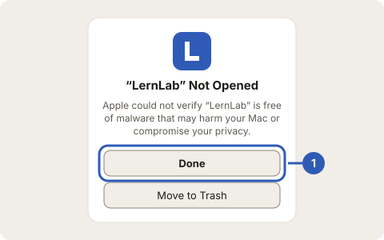
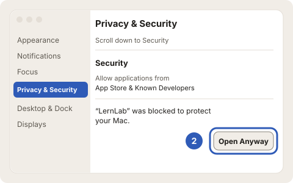
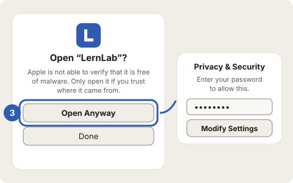
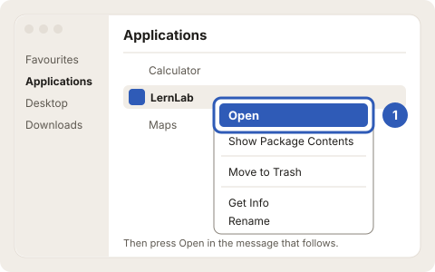
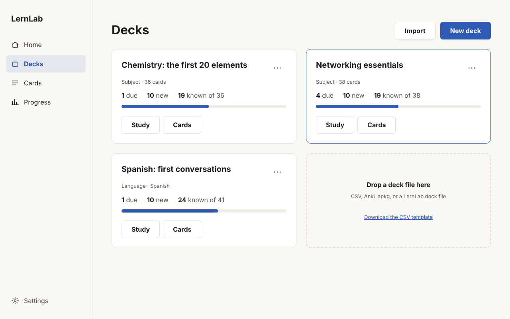

# LernLab

[](https://github.com/n1m5l5ss/lernlab/actions/workflows/ci.yml) [](https://scorecard.dev/viewer/?uri=github.com/n1m5l5ss/lernlab)

**Free, open-source flashcards that feel like a game, for any subject.**

> **Status:** Version 1.1.1 is out. <!-- x-release-please-version -->
> Get it from the [LernLab website](https://n1m5l5ss.github.io/lernlab/) or the [Releases page](https://github.com/n1m5l5ss/lernlab/releases/latest); what changed is in the [changelog](CHANGELOG.md) and what comes next in the [roadmap](docs/ROADMAP.md). Installers are not signed yet, so your system will warn you the first time you open LernLab (see [Install](#install) and the [code signing policy](docs/CODE_SIGNING.md)).



Languages, AWS, medicine, physics, law, history: if you can put it on a card, LernLab turns it into short, varied rounds with spaced repetition underneath.

- **Local and private:** no account, no cloud. Your decks and progress stay on your computer.
- **Runs on Mac, Windows and Linux.**
- **Opens your existing decks:** imports Anki `.apkg` packages with their review history, Quizlet-style CSV, pasted lists and live Anki.
- **Deck gallery:** browse free community decks and install one with a click.
- **No lock-in:** export any deck as a `.lernpack`, a CSV or an Anki `.apkg` with its media.
- **Safe with your data:** a daily backup, restore with a preview (each backup is checked before it replaces anything), and export everything as a zip.
- **For everyone:** works fully by keyboard and with screen readers, in light and dark themes, and lays out right to left for Arabic, Hebrew and Urdu.
- **Stays up to date:** Windows and Linux update themselves; Mac users download each new version from the website.
- **Bring your own AI assistant (optional):** connect Claude Desktop, the ChatGPT desktop app, Hermes Agent or any other assistant that supports MCP, to ask about your progress, be quizzed in the chat, turn a PDF into cards, fix, merge and tidy up cards, or plan a deck toward an exam. Every change waits for you to review and accept it in the app. Off until you turn it on, and LernLab itself stays offline. See [AI assistants](docs/AI-ASSISTANTS.md).

New here? The [user guide](docs/USER-GUIDE.md) shows how to import, study, follow your progress and back up.

## Why not just Anki?

Anki has the best scheduler there is, but reviewing in it means flipping one card after another. LernLab keeps the scheduler (FSRS, the same algorithm modern Anki uses) and changes the session.

- **Varied formats:** each session is a run of 60–90-second blocks, and the format changes from block to block:
  - multiple choice, typed recall, cloze;
  - sorting sprints, match pairs, word rain;
  - picture quizzes, listening, dictation, speaking, with your own recorded audio on any card;
  - exam-style multi-select questions, ordering;
  - math in LaTeX, and number answers with a tolerance and units;
  - code cards with syntax highlighting: predict the output, fill in the missing token, put the lines in order;
  - image occlusion: draw boxes over a picture and name each hidden part, one card per box;
  - a timed Blitz, and a boss fight over everything you missed;
  - "Guess first": before you meet the cards of a new topic, guess a few of its questions, then see the answers (practice only, no timer).
- **Ask each card in several ways:** add apply and analyse questions to a card ("A patient has X. Which drug?", "What if the dose doubles?"). Sessions take turns asking them, so you learn the idea and not just the wording, and the card keeps one schedule.
- **Learn from common mix-ups:** a multiple-choice card can explain why a wrong choice is wrong ("Many people think X. In fact Y."). Pick it and you see that note with the right answer, not just "wrong". Myth cards ask "True or myth?", then why.
- **Learn from your own mix-ups:** when your wrong answer is another card's answer, LernLab remembers the pair. The two cards become each other's wrong choice and are asked next to each other, and after three mix-ups you can add a compare card that shows both side by side.
- **Tell look-alikes apart:** the sorting round asks "Which one is this?" about the categories you mix up most (art styles, species, problem types), from a card's category or its tags. New words in a language deck are met in themed groups and mixed only in review.
- **How sure were you?** After about 1 in 4 recall answers, one optional tap from 1 to 5. A confident miss comes back once later in the session; at the end of a session you can say whether you'll know each new card tomorrow, and the next session shows how that went. Progress shows how often each rating was right at the next review. It never changes the schedule.
- **Explain it:** why and how cards where you write an explanation, then tick the key points you covered; that sets the grade, so you can't fool yourself with a quick flip.
- **Better cards:** mark the key part of an answer as `==term==` and it is highlighted when the answer shows. The card editor and the import preview suggest splitting an answer over 40 words, adding a picture to a card about an idea, and describing or dropping a picture that doesn't help. The rules run on your computer and never stop you saving.
- **Worked examples that fade:** for maths, science, code and accounting. Study a solved problem, then fill in its last step, then the last two, until you solve it alone. Only the whole problem changes your schedule.
- **Mock exams:** a tutor mode that explains each answer and counts toward your reviews, and a timed mode like the real thing, with flags, a pass mark, a score by topic and by question level.
- **Honest grading:**
  - you type or say the answer, and LernLab grades it;
  - it forgives capitals, small typos and German umlauts typed as `ae`, `oe`, `ue`;
  - there is an "I was right" button for when it's too strict.
- **Keeps you going:**
  - XP, levels, combos and badges, and the summary says what each XP reward was for;
  - **calm mode** hides XP, levels, combos and celebrations and keeps your progress, for people who prefer no game elements;
  - once per session you can swap a round for another format;
  - a streak with freezes (one missed day doesn't wipe you out);
  - an if-then study plan in your own words ("After I finish dinner, I'll study for 5 minutes"), which the daily reminder shows;
  - rescue rounds when you're struggling;
  - a quick action round when your attention drifts.
- **Learning science, not slot machines:**
  - new cards are never timed;
  - a missed card comes back a few cards later until you get it right, and a new card until you've recalled it twice;
  - recognition games never count as "knowing" a card;
  - only your first real recall each day moves the schedule.

<table>
<tr>
<td></td>
<td></td>
</tr>
</table>

## Install

Download the file for your system from the [LernLab website](https://n1m5l5ss.github.io/lernlab/), which picks the right one for you, or from the [Releases page](https://github.com/n1m5l5ss/lernlab/releases). The installers aren't signed with a paid certificate, so Windows and macOS warn you the first time you open LernLab: see [Opening LernLab on Windows for the first time](#opening-lernlab-on-windows-for-the-first-time) and [on a Mac](#opening-lernlab-on-a-mac-for-the-first-time), and the [code signing policy](docs/CODE_SIGNING.md). Everything LernLab needs is inside the installer: you don't need Node.js or anything else.

### Windows 10 and 11

#### Opening LernLab on Windows for the first time

**Why Windows warns you.** LernLab is free and open source, and it isn't signed with a paid code-signing certificate. Microsoft Defender SmartScreen warns about apps it doesn't know yet, so it says *"Windows protected your PC"*. The file on the website is the same file published on the [Releases page](https://github.com/n1m5l5ss/lernlab/releases), built in public from this repository. If you want to be sure, [check the download](docs/CODE_SIGNING.md#check-a-download-yourself) against the SHA-256 checksum GitHub shows for it.

**Your choice.** Opening it takes two extra clicks the first time. If you'd rather not, that's fine: nothing is installed until you run the installer, and you can delete the downloaded `LernLab-Setup-x.y.z.exe` from Downloads.

**The steps:**

1. Download `LernLab-Setup-x.y.z.exe`. If your browser says the file *isn't commonly downloaded*, keep it. In Edge, point at the download, press **…** → **Keep**, then **Show more** → **Keep anyway**. In Chrome, open the downloads list and choose to keep the file.

   
2. Open the downloaded file. A blue box says *"Windows protected your PC"*. Press **More info** (not Don't run).

   
3. The box now shows the file name and *"Publisher: Unknown publisher"*. Press **Run anyway**.

   
4. The installer runs by itself: no questions and no admin password (it installs just for you). When it's done, LernLab opens, and you'll find it in the Start menu and on the desktop. From now on it opens like any other app, and it updates itself.

   

**If Windows says Smart App Control blocked LernLab,** there is no Run anyway button on that computer: Smart App Control only allows signed apps. Please [ask for help](https://github.com/n1m5l5ss/lernlab/issues).

To uninstall: Settings → Apps → Installed apps → LernLab → Uninstall.

### macOS (Apple silicon and Intel)

Intel Macs are supported for as long as Apple and Electron support them; after that, only Apple silicon gets new versions (see [platform support](docs/RELEASING.md#installers)).

#### Opening LernLab on a Mac for the first time

**Why macOS warns you.** LernLab isn't signed with a paid Apple developer certificate (99 dollars a year). It is free and open source, and the file on the website is the same file published on the [Releases page](https://github.com/n1m5l5ss/lernlab/releases), built in public from this repository. If you want to be sure, [check the download](docs/CODE_SIGNING.md#check-a-download-yourself) against the checksum GitHub shows for it.

**Your choice.** Opening it takes one extra step the first time, about a minute. If you'd rather not, that's fine: nothing is installed until you drag LernLab into Applications, and you can drag the downloaded `.dmg` file from Downloads to the Bin.

**The steps (macOS 15 Sequoia and later):**

1. Download the `.dmg` for your Mac. The file with `arm64` in its name is for Apple silicon (M1 and newer); the other one is for Intel Macs.
2. Open it and drag **LernLab** into **Applications**. Open LernLab. macOS says *"LernLab" Not Opened*. Press **Done** (not Move to Trash).

   
3. Open the Apple menu → **System Settings** → **Privacy & Security**. Scroll down to Security. Next to *"LernLab" was blocked to protect your Mac*, press **Open Anyway**. The button stays there for about an hour after you tried to open the app.

   
4. macOS asks once more: press **Open Anyway**, then type your Mac's password (or use Touch ID). LernLab opens, and from now on it opens like any other app.

   

**macOS 14 Sonoma and earlier:** the steps above work too, or use the shortcut: in **Applications**, Control-click (or right-click) LernLab, choose **Open**, then press **Open** in the message. On macOS 15 and later this shortcut no longer works.



**If macOS says the app "is damaged"** (older LernLab versions on Apple silicon), it is only the download warning. Run this once in Terminal, then open it again:

```bash
xattr -dr com.apple.quarantine /Applications/LernLab.app
```

The Mac app can't update itself without a paid Apple certificate, so download each new version from the website. See the [code signing policy](docs/CODE_SIGNING.md) for details.

### Linux

- **AppImage** (any distribution): download `LernLab-x.y.z.AppImage`, make it executable and run it:

  ```bash
  chmod +x LernLab-*.AppImage
  ./LernLab-*.AppImage
  ```

  The AppImage updates itself.
- **Debian and Ubuntu:** download the `.deb` and open it, or run `sudo apt install ./lernlab_x.y.z_amd64.deb`. Download the next version the same way to update.

### Run from source

Requires Node.js 22.13 or newer.

```bash
git clone https://github.com/n1m5l5ss/lernlab.git
cd lernlab
npm install
npm run desktop      # builds and opens the desktop app
# or
npm start            # web version at http://localhost:5179
```

### Build installers yourself

```bash
npm run dist:mac     # → release/*.dmg   (run on a Mac)
npm run dist:win     # → release/*.exe   (run on Windows)
npm run dist:linux   # → release/*.AppImage, *.deb
```

Pushing a tag such as `v1.2.3` makes GitHub Actions build all three and attach them to a draft release (`.github/workflows/release.yml`).

## Getting cards in



Go to **Decks → Import**:

- **Drop a file:**
  - `.lernpack` (LernLab's own format, with media);
  - Anki `.apkg`;
  - CSV/TSV/TXT;
  - JSON;
  - a `.zip` containing a CSV plus its images and audio.
- **Paste a list:** `term, definition` per line, with any separator (Quizlet export works).
- **Live Anki:** with Anki open and the AnkiConnect add-on installed, pick decks and import.

You can also create and edit cards in **Cards**. A card can be:

- a basic card;
- a cloze (`{{c1::answer}}`);
- a multiple- or multi-select question with an explanation;
- an ordering card.

Any card can have an image, a GIF, audio or video.

### Example decks

Three ready-made decks in [`examples/`](examples/) show what LernLab can do. Download one and drop it on the Decks screen:

| Deck | What's inside |
|---|---|
| [Spanish: first conversations](examples/spanish-first-conversations.lernpack) | 41 cards: greetings, polite phrases, nouns with *el* and *la*, eight key verbs, with example sentences |
| [Networking essentials](examples/networking-essentials.lernpack) | 38 cards for entry-level networking exams: ports, OSI layers, IP addressing, exam-style questions |
| [Chemistry: the first 20 elements](examples/chemistry-first-20-elements.lernpack) | 36 cards: element names and symbols, metals and nonmetals, atoms and bonds |

There are more small decks (German, AWS, biology) and a template in [`examples/README.md`](examples/README.md). The full format spec is in [docs/FORMAT.md](docs/FORMAT.md).

### The `.lernpack` format

A zip containing `manifest.json`, a `cards.jsonl` file with one JSON card per line, and a `media/` folder. It is plain JSON, so it is easy to generate with a script or an AI, easy to diff, and media travel with the deck. Export any deck from **Decks → Export**. To go back to Anki, **Export for Anki** saves the deck as an `.apkg` with its media.

## Your data

Everything lives in one folder (`data/` inside the app-data location below): a SQLite database plus your media.

| System | Default location |
|---|---|
| macOS | `~/Library/Application Support/LernLab/` |
| Windows | `%APPDATA%\LernLab\` |
| Linux | `~/.config/LernLab/` |

LernLab backs up your database every day, before every update and before you delete anything, into `backups/` in the data folder. **Settings → Your data** has **Back up now**, **Restore a backup**, **Export everything** (one zip to move to another computer) and **Delete all my data**. See [Back up and move your data](docs/USER-GUIDE.md#back-up-and-move-your-data).

To move the folder, use **File → Use a different data folder…**, for example a Dropbox or Syncthing folder. Each day's summary is also written as JSON to `progress/`.

## Keyboard

- `1`–`4` choose an answer.
- `Enter` starts a session on Home, and checks or continues in a session.
- `Space` flips a card or replays audio.
- `Tab` shows a hint, then the answer, when you type.
- `Esc` leaves a session.
- `Ctrl/Cmd+Shift+L` starts a session from anywhere (desktop app).

## Docs

- [User guide](docs/USER-GUIDE.md)
- [Deck formats](docs/FORMAT.md)
- [Connect your own AI assistant (MCP)](docs/AI-ASSISTANTS.md)
- [Architecture](docs/ARCHITECTURE.md)
- [Roadmap](docs/ROADMAP.md)
- [Code signing policy](docs/CODE_SIGNING.md)
- [Security policy](SECURITY.md): how to report a vulnerability privately
- [Security practices](docs/SECURITY-PRACTICES.md), [testing](docs/TESTING.md) and our [OpenSSF Best Practices answers](docs/OPENSSF-BEST-PRACTICES.md)

## Contributing

```bash
npm test && npm run typecheck && npm run lint
```

The repo is an npm workspace: the engine lives in `packages/core` and the app in `apps/desktop`. Run every command from the repo root.

Issues and pull requests are welcome, especially new importers, card types, translations of the interface, and shared decks for `examples/`. Shared decks must be your own work or openly licensed. No copyrighted exam questions, please. [CONTRIBUTING.md](CONTRIBUTING.md) explains how to set up, test and open a pull request.

## Help run LernLab

LernLab is run by volunteers and is built to outlive any one of them, including its founder. Anyone can become a reviewer or a maintainer, or take over as lead. Use the [Join the team form](https://github.com/n1m5l5ss/lernlab/issues/new?template=join_team.yml). [GOVERNANCE.md](GOVERNANCE.md) explains how decisions are made and how a handover works, and the team is listed in [MAINTAINERS.md](MAINTAINERS.md).

## License

LernLab was originally created by kandru (aka [@n1m5l5ss](https://github.com/n1m5l5ss)); see [AUTHORS.md](AUTHORS.md).

MIT for the code. The example decks are CC0.
