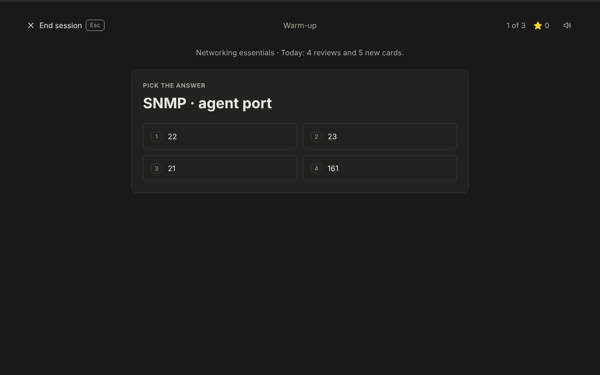
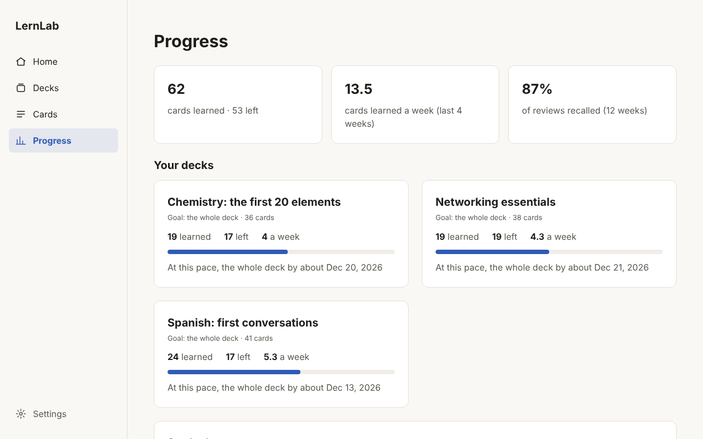

# LernLab

[](https://github.com/n1m5l5ss/lernlab/actions/workflows/ci.yml)

**Free, open-source flashcards that feel like a game, for any subject.**

> **Status:** Working prototype (v0.3). We are building version 1.0 now: see [docs/PLAN.md](docs/PLAN.md) and the [issues](https://github.com/n1m5l5ss/lernlab/issues). Installers are not signed yet, so your system will warn you the first time you open LernLab (see [Install](#install)).


Languages, AWS, medicine, physics, law, history: if you can put it on a card, LernLab turns it into short, varied rounds with spaced repetition underneath.

- **Local and private:** no account, no cloud. Your decks and progress stay on your computer.
- **Runs on Mac, Windows and Linux.**
- **Opens your existing decks:** imports Anki `.apkg` packages, Quizlet-style CSV, pasted lists and live Anki.

New here? The [user guide](docs/USER-GUIDE.md) shows how to import, study, follow your progress and back up.

## Why not just Anki?

Anki has the best scheduler there is, but reviewing in it means flipping one card after another. LernLab keeps the scheduler (FSRS, the same algorithm modern Anki uses) and changes the session.

- **Varied formats:** each session is a run of 60–90-second blocks, and the format changes from block to block:
  - multiple choice, typed recall, cloze;
  - sorting sprints, match pairs, word rain;
  - picture quizzes, listening, dictation, speaking;
  - exam-style multi-select questions, ordering;
  - a timed Blitz, and a boss fight over everything you missed.
- **Honest grading:**
  - you type or say the answer, and LernLab grades it;
  - it forgives capitals, small typos and German umlauts typed as `ae`, `oe`, `ue`;
  - there is an "I was right" button for when it's too strict.
- **Keeps you going:**
  - XP, levels, combos and badges;
  - a streak with freezes (one missed day doesn't wipe you out);
  - rescue rounds when you're struggling;
  - a quick action round when your attention drifts.
- **Learning science, not slot machines:**
  - new cards are never timed;
  - recognition games never count as "knowing" a card;
  - only your first real recall each day moves the schedule.

<table>
<tr>
<td></td>
<td></td>
</tr>
</table>

## Install

Download the file for your system from the [LernLab website](https://n1m5l5ss.github.io/lernlab/), which picks the right one for you, or from the [Releases page](https://github.com/n1m5l5ss/lernlab/releases). The installers are not signed yet, so Windows and macOS show a warning the first time. Everything LernLab needs is inside the installer: you don't need Node.js or anything else.

### Windows 10 and 11

1. Download `LernLab-Setup-x.y.z.exe`.
2. Double-click it. If SmartScreen says "Windows protected your PC", choose **More info → Run anyway**.
3. Follow the installer. Installing it just for you doesn't need admin rights.
4. Start LernLab from the Start menu.

### macOS (Apple silicon and Intel)

1. Download the `.dmg` for your Mac. The file with `arm64` in its name is for Apple silicon (M1 and newer); the other one is for Intel Macs.
2. Open it and drag **LernLab** into **Applications**.
3. Open LernLab. The first time, macOS says it can't check the app. Close the message, go to **System Settings → Privacy & Security**, scroll down and press **Open Anyway**. On macOS 14 and older you can instead right-click the app and choose **Open**.
4. If macOS says the app "is damaged", it is only the download warning. Run this once in Terminal, then open it again:

   ```bash
   xattr -dr com.apple.quarantine /Applications/LernLab.app
   ```

Automatic updates on a Mac need a signed app, so for now download each new version yourself.

### Linux

- **AppImage** (any distribution): download `LernLab-x.y.z.AppImage`, make it executable and run it:

  ```bash
  chmod +x LernLab-*.AppImage
  ./LernLab-*.AppImage
  ```

  The AppImage updates itself.
- **Debian and Ubuntu:** download the `.deb` and open it, or run `sudo apt install ./lernlab_x.y.z_amd64.deb`. Download the next version the same way to update.

### Run from source

Requires Node.js 22.13 or newer.

```bash
git clone https://github.com/n1m5l5ss/lernlab.git
cd lernlab
npm install
npm run desktop      # builds and opens the desktop app
# or
npm start            # web version at http://localhost:5179
```

### Build installers yourself

```bash
npm run dist:mac     # → release/*.dmg   (run on a Mac)
npm run dist:win     # → release/*.exe   (run on Windows)
npm run dist:linux   # → release/*.AppImage, *.deb
```

Pushing a tag such as `v0.2.0` makes GitHub Actions build all three and attach them to a draft release (`.github/workflows/release.yml`).

## Getting cards in


Go to **Decks → Import**:

- **Drop a file:**
  - `.lernpack` (LernLab's own format, with media);
  - Anki `.apkg`;
  - CSV/TSV/TXT;
  - JSON;
  - a `.zip` containing a CSV plus its images and audio.
- **Paste a list:** `term, definition` per line, with any separator (Quizlet export works).
- **Live Anki:** with Anki open and the AnkiConnect add-on installed, pick decks and import.

You can also create and edit cards in **Cards**. A card can be:

- a basic card;
- a cloze (`{{c1::answer}}`);
- a multiple- or multi-select question with an explanation;
- an ordering card.

Any card can have an image, a GIF, audio or video.

### Example decks

Three ready-made decks in [`examples/`](examples/) show what LernLab can do. Download one and drop it on the Decks screen:

| Deck | What's inside |
|---|---|
| [Spanish: first conversations](examples/spanish-first-conversations.lernpack) | 41 cards: greetings, polite phrases, nouns with *el* and *la*, eight key verbs, with example sentences |
| [Networking essentials](examples/networking-essentials.lernpack) | 38 cards for entry-level networking exams: ports, OSI layers, IP addressing, exam-style questions |
| [Chemistry: the first 20 elements](examples/chemistry-first-20-elements.lernpack) | 36 cards: element names and symbols, metals and nonmetals, atoms and bonds |

There are more small decks (German, AWS, biology) and a template in [`examples/README.md`](examples/README.md). The full format spec is in [docs/FORMAT.md](docs/FORMAT.md).

### The `.lernpack` format

A zip containing `manifest.json`, a `cards.jsonl` file with one JSON card per line, and a `media/` folder. It is plain JSON, so it is easy to generate with a script or an AI, easy to diff, and media travel with the deck. Export any deck from **Decks → Export**.

## Your data

Everything lives in one folder (`data/` inside the app-data location below): a SQLite database plus your media.

| System | Default location |
|---|---|
| macOS | `~/Library/Application Support/LernLab/` |
| Windows | `%APPDATA%\LernLab\` |
| Linux | `~/.config/LernLab/` |

LernLab backs up your database every day, before every update and before you delete anything, into `backups/` in the data folder. **Settings → Your data** has **Back up now**, **Restore a backup**, **Export everything** (one zip to move to another computer) and **Delete all my data**. See [Back up and move your data](docs/USER-GUIDE.md#back-up-and-move-your-data).

To move the folder, use **File → Use a different data folder…**, for example a Dropbox or Syncthing folder. Each day's summary is also written as JSON to `progress/`.

## Keyboard

- `1`–`4` choose an answer.
- `Enter` starts a session on Home, and checks or continues in a session.
- `Space` flips a card or replays audio.
- `Tab` shows a hint, then the answer, when you type.
- `Esc` leaves a session.
- `Ctrl/Cmd+Shift+L` starts a session from anywhere (desktop app).

## Docs

- [User guide](docs/USER-GUIDE.md)
- [Deck formats](docs/FORMAT.md)
- [Architecture](docs/ARCHITECTURE.md)
- [Roadmap](docs/ROADMAP.md)

## Contributing

```bash
npm test && npm run typecheck && npm run lint
```

The repo is an npm workspace: the engine lives in `packages/core` and the app in `apps/desktop`. Run every command from the repo root.

Issues and pull requests are welcome, especially new importers, card types, translations of the interface, and shared decks for `examples/`. Shared decks must be your own work or openly licensed. No copyrighted exam questions, please. [CONTRIBUTING.md](CONTRIBUTING.md) explains how to set up, test and open a pull request.

## License

MIT for the code. The example decks are CC0.
